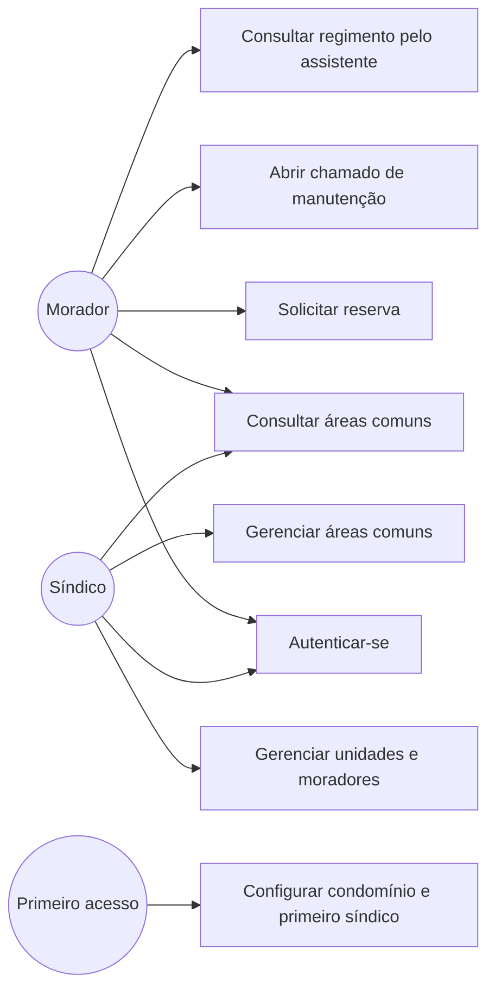
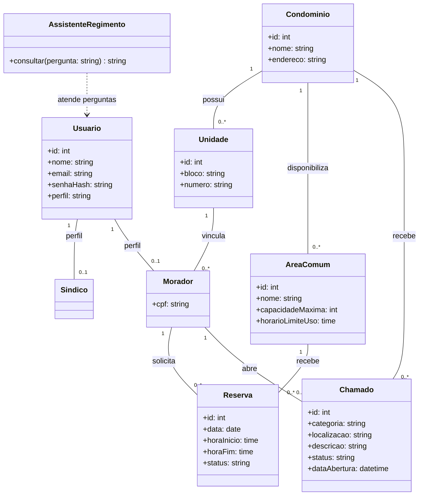

# Diagramas UML — VivaCondo

**Equipe:** Guilherme Rastelli Fernandes (RA 2840482421047), Felipe Savegnago Pires (RA 2840482421034), Marcus Vinicius Milan (RA 2840482421001)

Os diagramas abaixo separam as funcionalidades implementadas das previstas no backlog. O assistente é um serviço que lê um arquivo de texto; não há tabela `regimento` no banco de dados atual.

## 1. Diagrama de Casos de Uso

## 2. Diagrama de Classes

## 3. Rastreabilidade — caso de uso → história do backlog

| Caso de uso | História (E2) | Situação no código |
|---|---:|---|
| Autenticar-se | #1 | Implementado |
| Gerenciar unidades e moradores | #2 | Implementado |
| Gerenciar áreas comuns | #3 | Implementado |
| Solicitar reserva | #4 | Implementado |
| Abrir chamado de manutenção | #5 | Implementado |
| Consultar regimento pelo assistente | #6 | Implementado; depende de arquivo e chave configurados |
| Atualizar chamados | #7 | Não implementado |
| Consultar painel agregado | #8 | Não implementado no backend |
| Atualizar regimento por PDF | #9 | Não implementado |
| Consultar histórico | #10 | Não implementado |
| Exportar relatório | #11 | Não implementado no backend |
