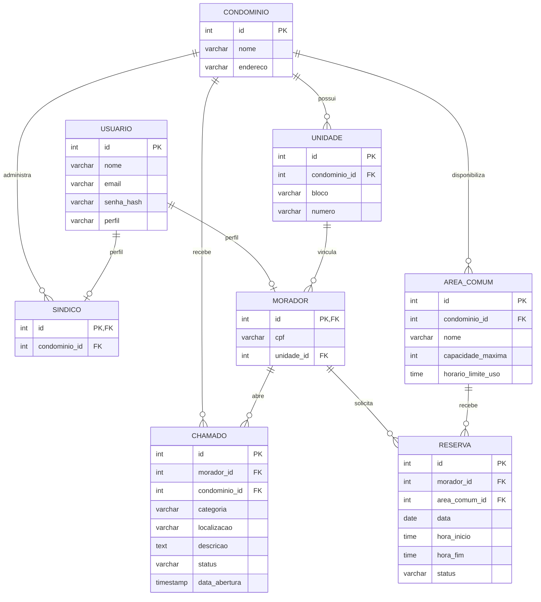

# DER — VivaCondo

**Equipe:** Guilherme Rastelli Fernandes (RA 2840482421047), Felipe Savegnago Pires (RA 2840482421034), Marcus Vinicius Milan (RA 2840482421001)

Este DER descreve as oito tabelas do schema PostgreSQL aplicado pela API. O relacionamento muitos-para-muitos entre moradores e áreas comuns ocorre ao longo do tempo e é resolvido pela entidade associativa `reserva`. O regimento é um arquivo externo, não uma tabela.

## 1. Diagrama

## 2. Dicionário de dados

### Tabela: `condominio`

| Campo | Tipo PostgreSQL | Restrições | Descrição |
|---|---|---|---|
| id | SERIAL | PK | Identificador do condomínio |
| nome | VARCHAR(150) | NOT NULL | Nome do condomínio |
| endereco | VARCHAR(255) | NOT NULL | Endereço |

### Tabela: `usuario`

| Campo | Tipo PostgreSQL | Restrições | Descrição |
|---|---|---|---|
| id | SERIAL | PK | Identificador do usuário |
| nome | VARCHAR(100) | NOT NULL | Nome |
| email | VARCHAR(150) | NOT NULL | E-mail de login; índice único sem diferenciar maiúsculas/minúsculas |
| senha_hash | VARCHAR(255) | NOT NULL | Hash derivado da senha |
| perfil | VARCHAR(20) | NOT NULL, CHECK | `MORADOR` ou `SINDICO` |

### Tabela: `unidade`

| Campo | Tipo PostgreSQL | Restrições | Descrição |
|---|---|---|---|
| id | SERIAL | PK | Identificador da unidade |
| condominio_id | INT | FK, NOT NULL | Condomínio da unidade |
| bloco | VARCHAR(20) | NOT NULL | Bloco |
| numero | VARCHAR(20) | NOT NULL | Número |
| — | — | Índice UNIQUE por condomínio, `lower(bloco)`, `lower(numero)` | Impede unidade duplicada ignorando caixa |

### Tabela: `sindico`

| Campo | Tipo PostgreSQL | Restrições | Descrição |
|---|---|---|---|
| id | INT | PK, FK → `usuario.id`, ON DELETE CASCADE | Usuário síndico |
| condominio_id | INT | FK, NOT NULL | Condomínio administrado |

### Tabela: `morador`

| Campo | Tipo PostgreSQL | Restrições | Descrição |
|---|---|---|---|
| id | INT | PK, FK → `usuario.id`, ON DELETE CASCADE | Usuário morador |
| cpf | VARCHAR(11) | UNIQUE, NOT NULL, CHECK `cpf_valido(cpf)` | CPF validado |
| unidade_id | INT | FK, NOT NULL | Unidade vinculada |

### Tabela: `area_comum`

| Campo | Tipo PostgreSQL | Restrições | Descrição |
|---|---|---|---|
| id | SERIAL | PK | Identificador da área |
| condominio_id | INT | FK, NOT NULL | Condomínio da área |
| nome | VARCHAR(100) | NOT NULL | Nome; índice único por condomínio, sem diferenciar caixa |
| capacidade_maxima | INT | NOT NULL, CHECK > 0 | Capacidade |
| horario_limite_uso | TIME | NOT NULL | Limite de horário |

### Tabela: `reserva`

| Campo | Tipo PostgreSQL | Restrições | Descrição |
|---|---|---|---|
| id | SERIAL | PK | Identificador da reserva |
| morador_id | INT | FK, NOT NULL | Morador solicitante |
| area_comum_id | INT | FK, NOT NULL | Área reservada |
| data | DATE | NOT NULL | Data |
| hora_inicio | TIME | NOT NULL | Início |
| hora_fim | TIME | NOT NULL, CHECK > `hora_inicio` | Término |
| status | VARCHAR(20) | NOT NULL, DEFAULT `PENDENTE`, CHECK | `PENDENTE`, `CONFIRMADA` ou `CANCELADA` |

### Tabela: `chamado`

| Campo | Tipo PostgreSQL | Restrições | Descrição |
|---|---|---|---|
| id | SERIAL | PK | Identificador do chamado |
| morador_id | INT | FK, NOT NULL | Morador que abriu |
| condominio_id | INT | FK, NOT NULL | Condomínio relacionado |
| categoria | VARCHAR(100) | NOT NULL | Categoria |
| localizacao | VARCHAR(150) | NOT NULL | Local do problema |
| descricao | TEXT | NOT NULL | Descrição |
| status | VARCHAR(20) | NOT NULL, DEFAULT `ABERTO`, CHECK | `ABERTO`, `EM_ANDAMENTO`, `CONCLUIDO` ou `CANCELADO` |
| data_abertura | TIMESTAMP | NOT NULL, DEFAULT CURRENT_TIMESTAMP | Data e hora da abertura |

## 3. Observação de normalização

As tabelas de perfil (`morador` e `sindico`) estendem `usuario` por chave primária compartilhada. `reserva` resolve a relação N:N entre moradores e áreas comuns. O arquivo do regimento é configurado por caminho no ambiente e não é persistido neste schema.
